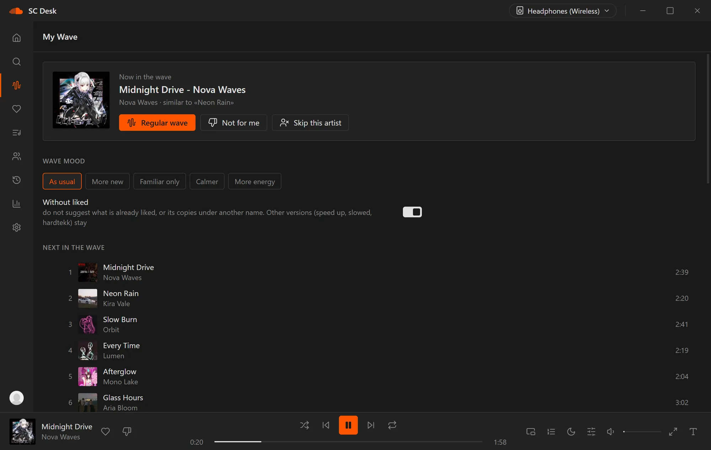

<p align="right"><b>English</b> | <a href="README.ru.md">Русский</a></p>

# SC Desk



A SoundCloud app for Windows. No ads, light on your PC, with synced lyrics and Discord status.

**[Download the latest version](https://github.com/b1rkarokK/SC-Desktop/releases/latest)** - the `SC.Desk_x.y.z_x64-setup.exe` file.

Installs in a couple of seconds, no admin rights needed. You get a desktop shortcut and a Start menu entry. The app finds updates on its own and installs them with one click.

## What it does

- Likes: tracks, albums, playlists (yours and liked ones), artists you follow
- My Wave: an endless mix based on your taste. Pick a mood and keep tracks you already liked out of it
- Search all of SoundCloud, open track, artist and playlist pages
- Lyrics that light up in time with the song, sometimes word by word. There's a fullscreen mode you can tweak
- Rooms: listen together, one track at everyone's place at once (audio and chat are not sent, only commands). A room stays in "My rooms" and the host passes on by itself
- Shared playlists: one list for everybody, with roles, history of changes and a picture or colour of your own
- Friends: requests, a list, invitations to rooms and playlists, and what a friend is listening to right now. Everything is encrypted on your devices
- Listening history by day and a yearly recap
- 10-band equalizer, slowed / sped up, reverb, crossfade; a separate equalizer for every output device
- Themes: OLED, dark, light, and your own (colours, a background picture, your own CSS)
- Hotkeys of your own that work over games too. One shows a plate with the song or the current lyric line over a game for 3 seconds, another makes the mini player clickable in a game
- A page for OBS: the song and the current lyric line for streaming (reachable only on your computer)
- Translation of lyric lines, finding a song by a line of its lyrics (your likes first, then all of SoundCloud), search in the history
- Duplicates in your likes: the same song from different uploaders can be cleaned up in a couple of clicks
- Small things for the evening: "quieter at night", the accent colour of the interface from the cover, list density, long mixes continue where you stopped
- Discord status: what's playing, cover art, time left, and a "Join" button for an open room
- Lives in the tray, works with media keys, can start with Windows
- Switch headphones or speakers mid-song and the sound follows

No ads at all. Audio comes straight from SoundCloud, without the inserts the website plays. The installer is about 7 MB (Electron clients are usually over 150 MB), and the app sends nothing through servers of someone else: signing in and likes go straight to SoundCloud.

## Signing in

Settings - "Sign in with SoundCloud". The regular SoundCloud login window opens, you can use email, Google, Facebook or Apple. Your login is kept in the Windows credential store and never leaves your PC.

## If SoundCloud doesn't load

By default the app goes online the same way your browser does, so if you use a VPN, it works through it. You can also set your own proxy in Settings - Network, there's a short guide and a "Check" button.

Tracks blocked in your country and SoundCloud Go+ tracks (they're DRM protected) are skipped.

## Building it yourself

You'll need Node.js 22+ and Rust.

```bash
npm ci
npm run tauri dev
npm run tauri build
```

---

SC Desk is an unofficial app and isn't affiliated with SoundCloud.

## Лицензия

Все права защищены, подробности в файле [LICENSE](LICENSE). Код открыт для чтения, копировать и распространять его без разрешения автора нельзя.
