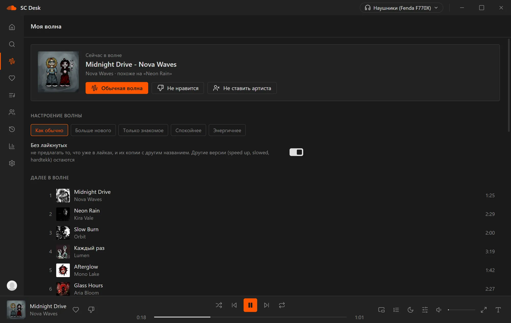

<p align="right"><a href="README.md">English</a> | <b>Русский</b></p>

# SC Desk



Программа для SoundCloud на Windows. Без рекламы, лёгкая, с текстами песен и статусом в Discord.

**[Скачать последнюю версию](https://github.com/b1rkarokK/SC-Desktop/releases/latest)** - файл `SC.Desk_x.y.z_x64-setup.exe`.

Ставится за пару секунд, права администратора не нужны. Ярлык появится на рабочем столе и в меню Пуск. Обновления программа находит сама и ставит по кнопке, ничего качать заново не надо.

## Что умеет

- Лайки: треки, альбомы, плейлисты (и свои, и лайкнутые), артисты, на которых вы подписаны
- Моя волна: бесконечная подборка по вашему вкусу. Можно выбрать настроение и убрать из волны то, что уже в лайках
- Поиск по всему SoundCloud, страницы треков, артистов и плейлистов
- Тексты песен, которые подсвечиваются в такт, иногда прямо по словам. Есть полноэкранный режим, где можно настроить вид
- Комнаты: слушайте вместе, один трек у всех одновременно (звук и переписка не передаются, только команды). Комната остаётся в «Моих комнатах», хост передаётся сам
- Общие плейлисты: один список на всех, с ролями, историей изменений и своей картинкой или цветом
- Друзья: запросы, список, приглашения в комнаты и плейлисты и то, что друг слушает прямо сейчас. Всё шифруется на ваших устройствах
- История прослушиваний по дням и итоги года
- Эквалайзер на 10 полос, slowed / sped up, реверберация, кроссфейд; свой эквалайзер для каждого устройства вывода
- Темы: OLED, тёмная, светлая и свои (цвета, фоновая картинка, свой CSS)
- Свои горячие клавиши, которые работают и поверх игр
- Статус в Discord: что играет, обложка, сколько осталось и кнопка «Присоединиться» к открытой комнате
- Работает из трея, понимает медиаклавиши, может запускаться вместе с Windows
- Если переключить наушники или колонки прямо во время песни, звук сам перейдёт на них

Рекламы нет вообще. Звук идёт напрямую, без вставок, которые крутит сайт.

## Вход

Настройки - «Войти через SoundCloud». Откроется обычное окно входа SoundCloud, можно войти через почту, Google, Facebook или Apple. Данные входа хранятся в защищённом хранилище Windows и больше никуда не уходят.

## Если SoundCloud не открывается

По умолчанию программа ходит в интернет так же, как браузер. Если у вас включён VPN или «запрет», она работает через них. Можно указать свой прокси: Настройки - Сеть, там же есть подсказка и кнопка «Проверить».

Треки, закрытые в вашей стране, и треки SoundCloud Go+ (они защищены) программа пропускает.

## Собрать самому

Нужны Node.js 22+ и Rust.

```bash
npm ci
npm run tauri dev
npm run tauri build
```

---

SC Desk - неофициальная программа, к SoundCloud отношения не имеет.
